<p align="center">
  
</p>

<p align="center">
  
  
  
  
</p>

<p align="center"><b>A roleplaying cyberpunk city.</b></p>

Lowlight is a rain-soaked port city you play through conversation. Each character is an AI with
their own model, their own pixel-art rooms and their own hours on the map. They dim the lights,
move the clock, take work from their clients and remember what you did. You walk the districts,
take jobs and gigs, crack lacquer, hire a crew, and earn trust from people who don't give it easily.

It runs on your own machine. Bring an OpenRouter key; the characters' turns go to the models you pick.

<p align="center">
  
</p>
<p align="center">
  
  
</p>

## Features

### Contacts

<p align="center">
  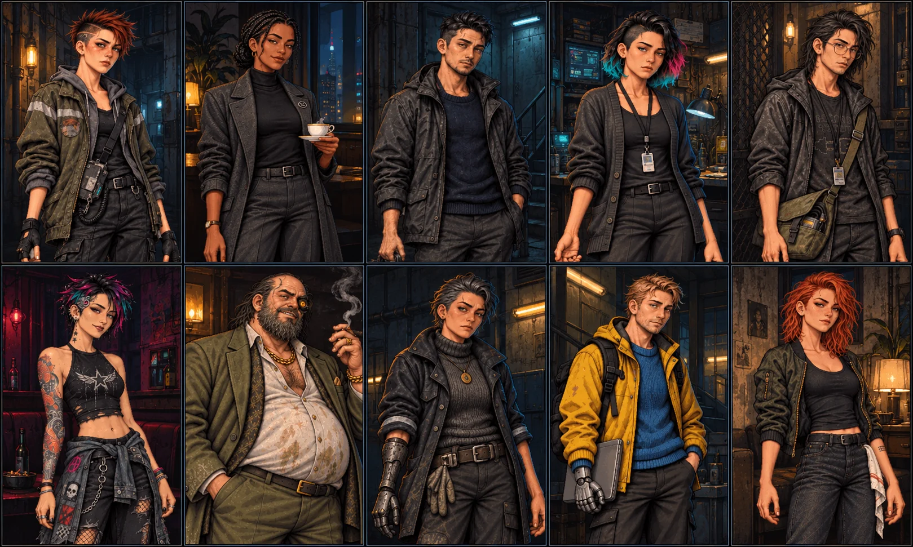
</p>

A contact is the person you call on the select screen: Nix, Cass, Hicks, Ines and the rest. Each one runs on
the model you give them, keeps their own hours and remembers you between nights.

- **They travel with you.** Pick a place on the MAP and GO: they come along, and the scene moves with you.
  Once Nix trusts you enough to take the Chair, she can work ON COMMS instead, in your ear from her desk while
  you go alone.
- **They can leave you.** They have their own plans and schedules. When it's time for them to go, you get the
  choice to LET THEM GO or GO WITH THEM.
- **You can leave them.** END SCENE → LEAVE → WALK OUT ends the scene cleanly. AROUND LOWLIGHT then lists
  everyone by where they are, so you can call someone else or go back to the one you left.
- **They point you to each other.** A contact can give you a lead: a name, a place, someone who knows
  something, with the details filled in by the one telling you. Raise it with the person it points to and they
  know what you mean; leave it, and they won't bring it up. Some leads open the next. They wait for you in
  PEOPLE → LEADS (Alt+L).
- **You can text them.** The deck is a phone for Cortex Relay, the city's network: texts arrive wherever their
  schedule has them, they know you aren't there, and they'll text you when they said they would. A scene
  remembers the day's texts, and the texts remember the scene. Open `/deck` in the browser, or on your phone:
  1. Run from source, with [Tailscale](https://tailscale.com) on your PC and phone.
  2. Put your PC's tailnet name in `.env` (`NIX_ROOM_ALLOWED_HOSTS=<your-pc>.<tailnet>.ts.net`) and restart
     `npm run dev`.
  3. Run `tailscale serve --bg http://localhost:5173`, then open `https://<your-pc>.<tailnet>.ts.net/deck` on
     the phone and add it to your home screen.

  `tailscale serve` stays inside your own tailnet. Never use `tailscale funnel`: it makes the game, your saves
  and your key's spending public.

### Fixed characters

<p align="center">
  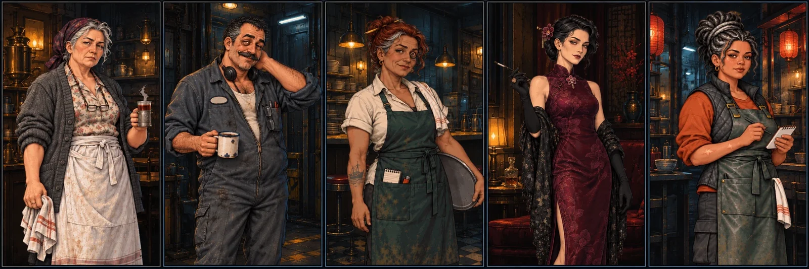
</p>

Some people belong to a place, not to your contact list. Oksana keeps her counter on the Spine, Garro sits
in the Listening Post, Tilly waits tables at the Breakwater, Vesna hosts the Glass Orchid, and Hae runs the
noodle stall. They're always there in their hours, and whoever you bring in meets
them. Your contact's model plays them in the same reply, so they share the scene's memory instead of costing
a second call.

### The Residual


After every reply, a second, quiet call reads what just happened and keeps the Black Ledger, so the
character's own model only has to write story. The Residual keeps what they remember about you, how they feel
about you, the hour, where they said they'd be next, and what they promised to text. It moves the clock when a
reply forgets to and catches the lights they forgot to dim. Nothing it keeps lives in the chat, so the model
can't talk its way out of it.

**Cipher** (coming next) is the part of the Ledger you never get to read. The city keeps secrets: what someone
hides about themselves, what's between two people, what a place really is, what's moving in the streets, and
what grew out of your own playthrough. The Residual keeps two or three of them open at a time, and only the
people who'd know a secret are told it, so they guard it the way they would. Clues surface in the story over
time. What you notice goes into LOOSE ENDS on the PEOPLE screen, where and when you saw it, and a truth only
shows there once you've learned it.

<br clear="right">

### Quests, jobs, big jobs and gigs

<p align="center">
  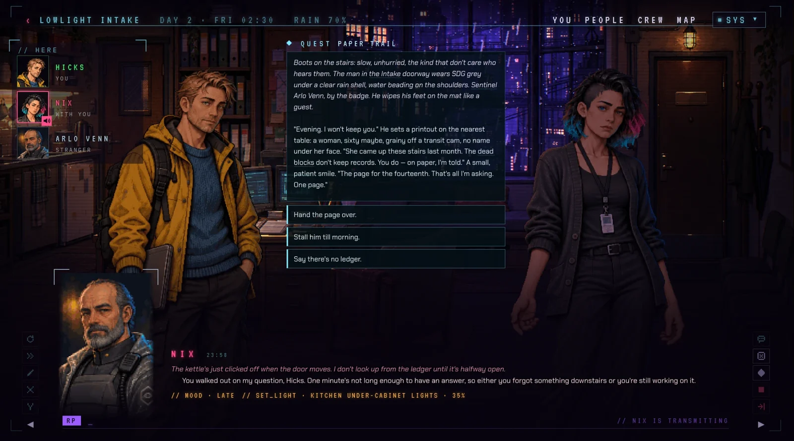
  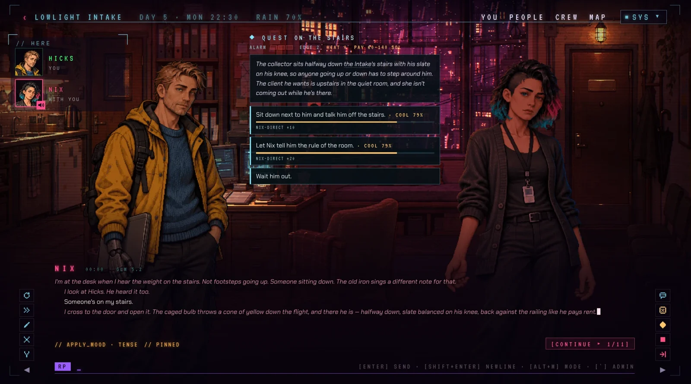
</p>

- **Quests** are written stories with real choices. A card comes up under the HUD and you talk it over with
  your contact first: each of them sees the options their own way, and some won't argue the ones they can't
  see.
- **Jobs** are one night's work off a board or from a fixer, tiered by how much the district trusts you. Your
  stats, your deck and your crew set the odds; EDGE buys a reroll. They pay in sol and cost you heat, and both
  are counted district by district. Nix's own clients bring jobs to the Intake, with her trust as the stake.
- **Big jobs** take several nights: legwork at the places they name, clues, your read on what's really going
  on, and two or three ways in.

<p align="center">
  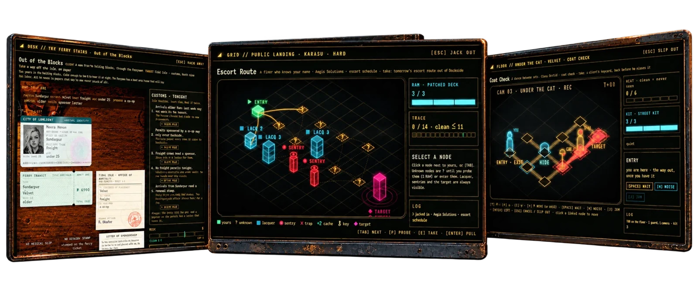
</p>

**Gigs** are the part you play with your hands, and where a big job ends up:

- **Papers:** a desk, a client, and tonight's customs rules. Build them an identity out of permits, stamps
  and letters that gets past the clerk, before the risk adds up.
- **Grid:** jack in and work a network node by node toward the target. Probe what you can't see, spend RAM
  to break lacquer, keep away from sentries, and pull the take before the trace finishes you.
- **Slip:** cross a floor plan past guards and cameras a step at a time. Wait, hide, make a noise, jam a
  camera with your kit, and get out with heat at zero if you can.

### The YOU panel

<p align="center">
  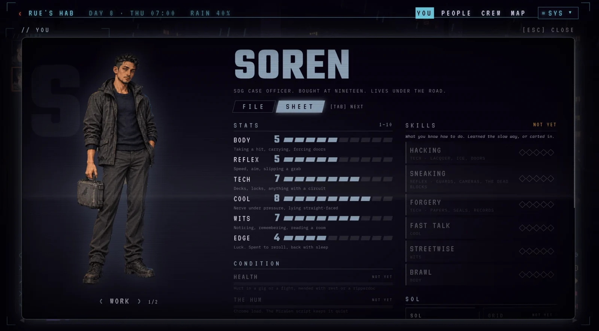
</p>

YOU (Alt+Y) opens on your FILE: who you are, from the select screen or your own persona. Tab turns to the
SHEET and on to PEOPLE: your journal, your contacts' files and standing, and the leads you've been given.

The SHEET shows your six stats (body, reflex, tech, cool, wits, edge), the numbers your jobs roll against,
and your figure, where you change outfits. The rest is laid out but marked NOT YET, as a roadmap you can read
in game: CONDITION (health, the hum of your chrome, SDG heat), SKILLS, grid and hard SOL, and CHROME & GEAR.

### Crew

<p align="center">
  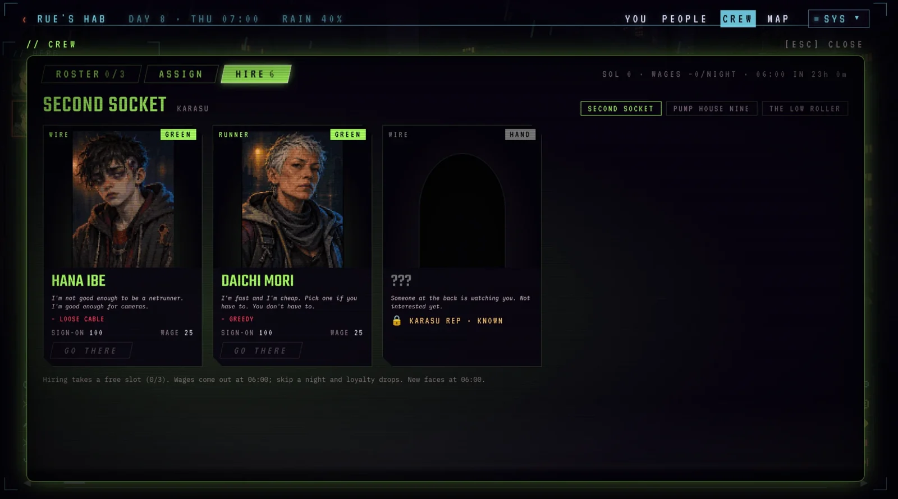
</p>

CREW (Alt+K) is people you send instead of going yourself. Hire them where hiring happens: a runner, ears, a
face, a fence, muscle, a wheel, a wire. New faces turn up every morning, and better hires need more rep in
the district. You have three places on the roster; each hire costs a sign-on fee and a nightly wage, and a
skipped night costs loyalty. Each has traits, one of which you only learn after hiring, and a loyalty you
read as a word. Send them on errands that run on the story
clock while you play. They come back CLEAN, MESSY or BLOWN, and the losses are real: hurt, held by SDG, or
gone. Crew costs no model calls.

### Standing and romance

How each person feels about you is two hidden numbers, trust and warmth, shown only as a word in CONTACTS
("Wary", "Owes you"). They move slowly, a step at a time. Each character wants something and keeps a secret,
and the secret stays kept until they trust you. Romance is gated at the very top of both, and some need a
story to happen first. Things you do can set it back.

### The city

<p align="center">
  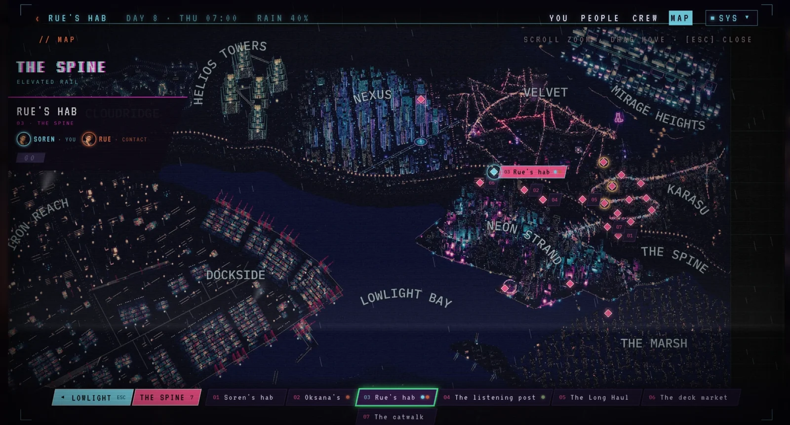
  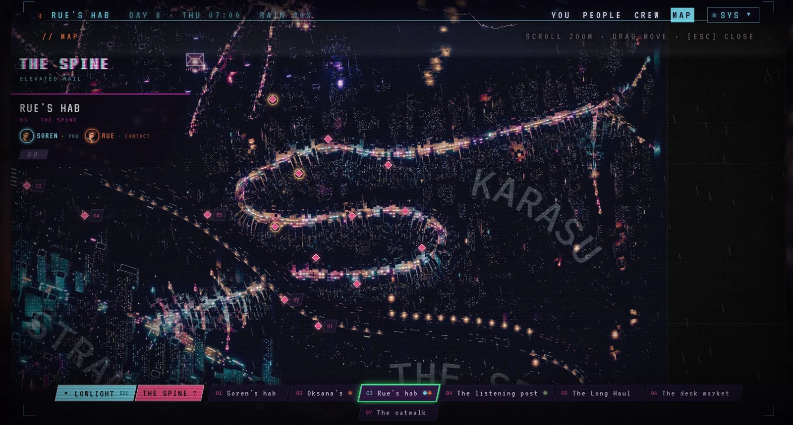
</p>

Lowlight is a rendered city map of districts, the bay and every place you can go. A story clock runs under it
(Day 1 is a Thursday): people keep schedules, venues keep hours, and a room's mood moves with the night. One
rain falls on the whole city and follows you room to room. When the power goes, rooms, the HUD and the map go
dark with it.

### Living rooms

<p align="center">
  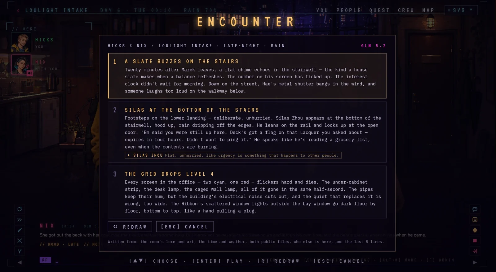
</p>

Every room is pixel art that the characters work: they dim the lights, change the mood, play a sound. Rain
runs down the glass, steam comes off Hae's pot, cars pass on the street, and the lamps light the figures
standing in them. Faces change with what people do.

When a scene stalls, ENCOUNTER has the narrator write three things that could happen next, from the room's
lore and art, the hour and weather, who's here and the last few lines. Play one, or REDRAW.

### Play anyone

<p align="center">
  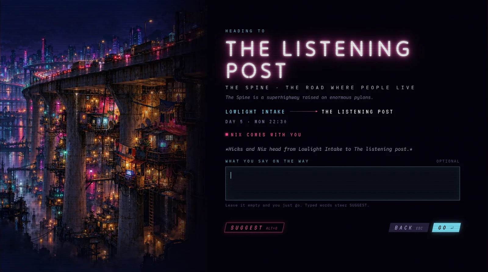
</p>

GO opens a screen for the trip: where you're heading, who comes with you, and a line you can say on the way
(or let SUGGEST draft it). Pick who you play and who you call, or write your own persona. Saves, LOAD and CONTINUE, rewind and swipe,
and BRANCH HERE to fork a playthrough from any line. The lore book feeds the city's history into each turn
when it comes up, and there's liar's dice at the Low Roller.

## Play it

- **The builds:** Windows and Linux, on [itch.io](https://lowlightgame.itch.io/lowlight). This is the easy way.
- **In SillyTavern:** the rooms, the cast, the lore book and the map as an extension: [Lowlight for SillyTavern](https://github.com/johdavken/lowlight-sillytavern).
- **From source:** this repository. It's the same game, every sound included.

## Soundtrack

<p align="center">
  <a href="https://soundcloud.com/jdecker-23907106/sets/lowlight-original-soundtrack">
    
  </a>
</p>

<p align="center"><a href="https://soundcloud.com/jdecker-23907106/sets/lowlight-original-soundtrack"><b>▶ Listen to the Lowlight soundtrack on SoundCloud</b></a></p>

## Run it from source

You need Node.js 24 or newer and an OpenRouter key.

```bash
npm ci
npm run dev
```

Open http://localhost:5173, pick who you play and who you call, and enter your key on the select
screen. [docs/BUILDING.md](docs/BUILDING.md) covers the desktop app, the city map's tiles, the tests and
where your saves live.

## What's in here

| Folder | What it holds |
| --- | --- |
| `server/` | The game server: turns, room tools, the story clock, saves |
| `web/` | The game in the browser: the rooms' renderer, the screens, the sound |
| `shared/` | What both sides agree on: schemas, quests, the map's data |
| `desktop/` | The desktop app (Electron) around the same server |
| `characters/` | The cast: who they are, how they talk, their sprites and faces |
| `scenes/` | The rooms, district by district, with their lights, moods and songs |
| `world/` | The lore book, jobs, quests, gigs, and the menu's art and music |
| `map/` | The city map and the data its 3D render is built from |

## How it's made

The art, the songs and the characters' writing are made with AI tools and edited by hand.

## Licences

- **Code:** GPL-3.0 or later ([LICENSE](LICENSE)).
- **Lowlight's own content** (the characters, rooms, lore, map, art and songs): CC BY-NC-SA 4.0
  ([CONTENT-LICENSE](CONTENT-LICENSE)). Credit it as "Lowlight by Farban".
- **Third-party material** keeps its own licence: [sounds/CREDITS.md](sounds/CREDITS.md), and what each
  one allows in [docs/LICENSING.md](docs/LICENSING.md).

## Issues and pull requests

This repository is exported from a private one on every update, so pull requests can't be merged
here. Bug reports and ideas are welcome as [issues](https://github.com/johdavken/lowlight/issues).
