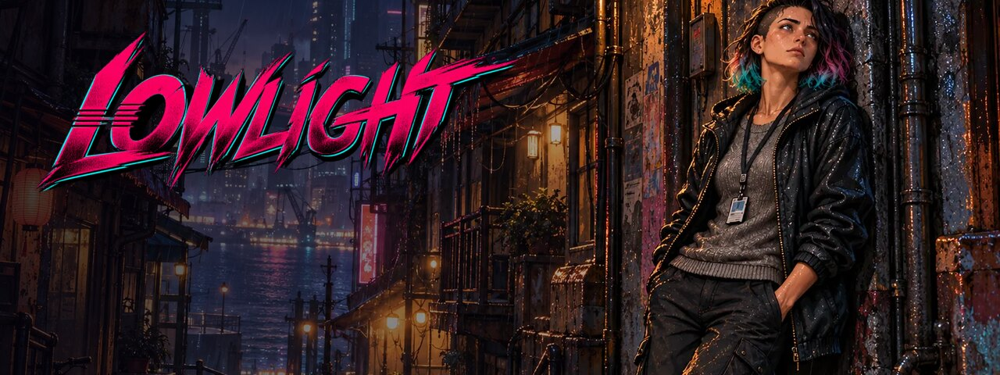
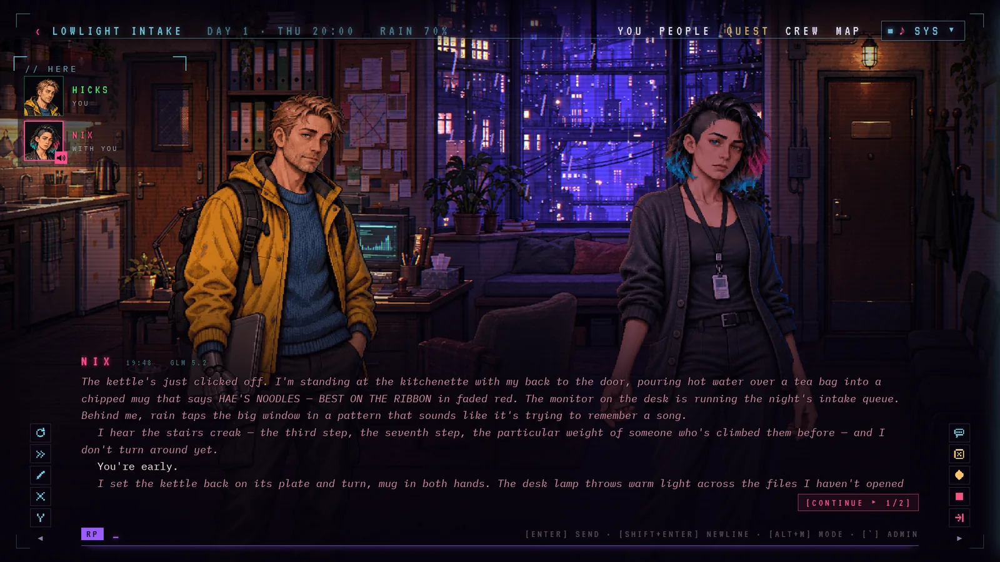
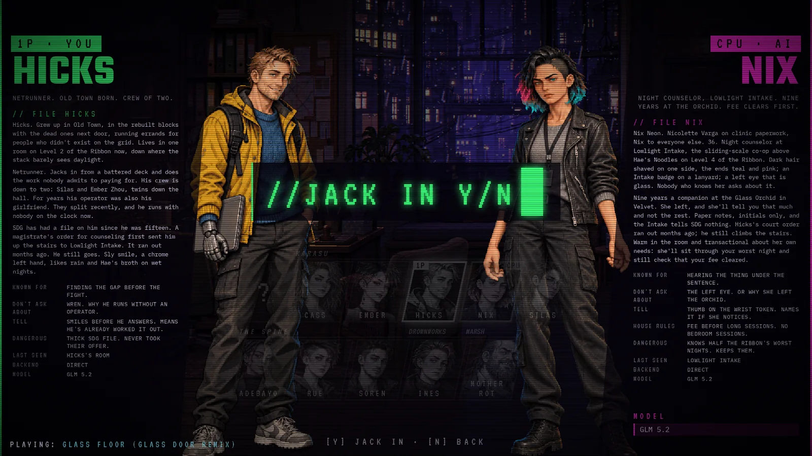
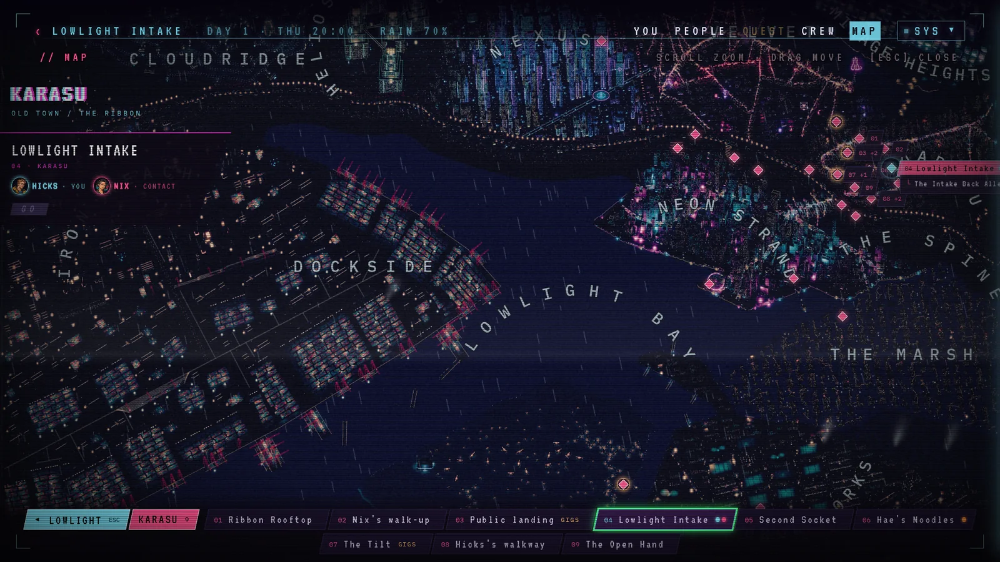

<p align="center">
  
</p>

<p align="center">
  
  
  
  
</p>

<p align="center"><b>A roleplaying cyberpunk city.</b></p>

Lowlight is a rain-soaked port city you play through conversation. Each character is an AI with
their own model, their own pixel-art rooms and their own hours on the map. They dim the lights,
move the clock, take work from their clients and remember what you did. You walk the districts,
take gigs and small jobs, crack ice, hire a crew, and earn trust from people who don't give it easily.

It runs on your own machine. Bring an OpenRouter key; the characters' turns go to the models you pick.

<p align="center">
  
</p>
<p align="center">
  
  
</p>

## Play it

- **The builds:** Windows and Linux, with every sound, on [itch.io](https://lowlightgame.itch.io/lowlight). This is the easy way.
- **From source:** this repository. It's the same game, with a few menu and minigame sounds missing: see [why](#why-some-sounds-are-silent).

## Run it from source

You need Node.js 24 or newer and an OpenRouter key.

```bash
npm ci
npm run dev
```

Open http://localhost:5173, pick who you play and who you call, and enter your key on the select
screen. [docs/BUILDING.md](docs/BUILDING.md) covers the desktop app, the city map's tiles, the tests and
where your saves live.

## What's in here

| Folder | What it holds |
| --- | --- |
| `server/` | The game server: turns, room tools, the story clock, saves |
| `web/` | The game in the browser: the rooms' renderer, the screens, the sound |
| `shared/` | What both sides agree on: schemas, quests, the map's data |
| `desktop/` | The desktop app (Electron) around the same server |
| `characters/` | The cast: who they are, how they talk, their sprites and faces |
| `scenes/` | The rooms, district by district, with their lights, moods and songs |
| `world/` | The lore book, jobs, quests, gigs, and the menu's art and music |
| `map/` | The city map and the data its 3D render is built from |

## Why some sounds are silent

The builds use some licensed sound effects for the menus and the minigames. Their licences allow them
inside a finished game, but not as loose files anyone can download, so this repository leaves them out
and the game skips them quietly. Everything else is here: the songs, the rain, the thunder and every
room's ambience. Every sound's source and licence is in [sounds/CREDITS.md](sounds/CREDITS.md).

## How it's made

The art, the songs and the characters' writing are made with AI tools and edited by hand.

## Licences

- **Code:** GPL-3.0 or later ([LICENSE](LICENSE)).
- **Lowlight's own content** (the characters, rooms, lore, map, art and songs): CC BY-NC-SA 4.0
  ([CONTENT-LICENSE](CONTENT-LICENSE)). Credit it as "Lowlight by Farban".
- **Third-party material** keeps its own licence: [sounds/CREDITS.md](sounds/CREDITS.md), and what each
  one allows in [docs/LICENSING.md](docs/LICENSING.md).

## Issues and pull requests

This repository is exported from a private one on every update, so pull requests can't be merged
here. Bug reports and ideas are welcome as [issues](https://github.com/johdavken/lowlight/issues).
